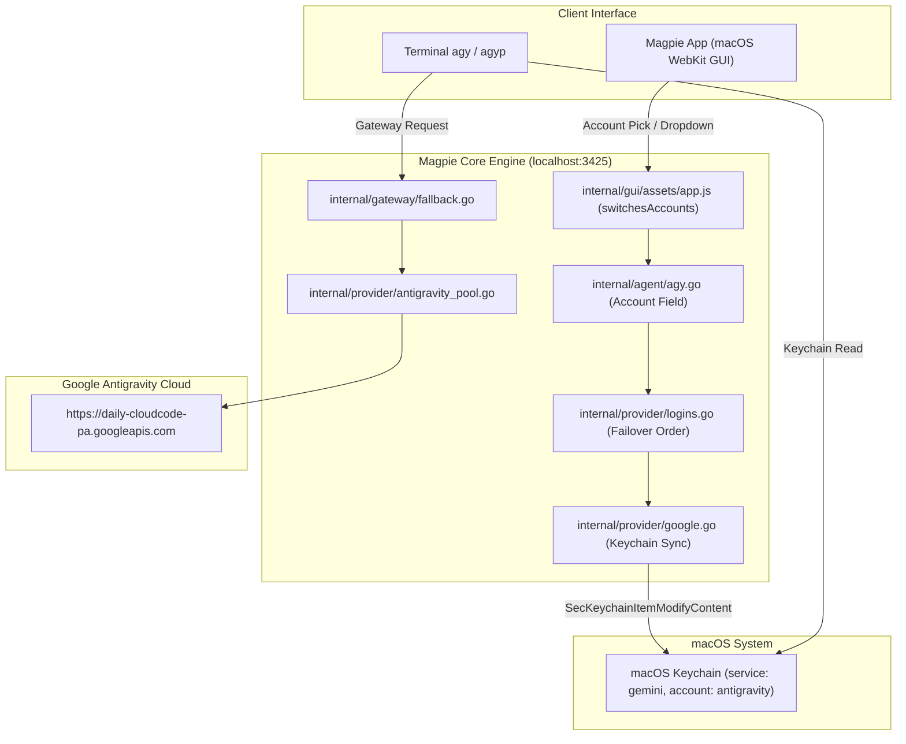

# Antigravity CLI (agy) Multi-Account Manual & System Architecture

> **krazyeom Custom Build** · Repository: [github.com/krazyeom/magpie](https://github.com/krazyeom/magpie)  
> Version: `v0.1.2374-krazyeom.1`

---

## 1. 개요 및 배경

Google의 **Antigravity CLI(`agy`)**는 기본적으로 macOS 시스템 키체인(`service: gemini, account: antigravity`)에 단 1개의 OAuth 토큰만 저장하도록 제한되어 있습니다. CLI 자체에는 다중 프로필 전환 기능(`--profile` 등)이 없어, 여러 개의 Google 계정(예: Google AI Pro 계정 복수 보유)을 사용할 때 계정을 손쉽게 고르거나 쿼터 소진 시 자동으로 넘어가게 하는 처리가 불가능합니다.

이 커스텀 빌드(`krazyeom/magpie`)는 로컬 AI 게이트웨이인 Magpie를 기반으로 **Antigravity 다중 계정 풀링, 자동 페일오버(Failover), GUI/CLI 실시간 스위칭 및 시스템 키체인 양방향 동기화**를 완벽하게 구현했습니다.

---

## 2. 핵심 기능

1. **다중 계정 풀링 및 자동 페일오버**:
   * 등록된 모든 Antigravity 계정의 사용량을 실시간 추적하고, 분당 제한(RPM)이나 할당량(429) 초과 시 차순위 활성 계정으로 즉시 우회하여 작업을 지속합니다.
2. **Magpie GUI 앱 내 3중 계정 전환 지원**:
   * **Agents 탭 빠른 스위처**: 에이전트 목록의 Antigravity 행에 위치한 계정 뱃지를 클릭하여 원클릭 팝업 메뉴로 전환.
   * **Agents 설정 서랍**: 행 클릭 시 열리는 상세 설정의 `Account` 드롭다운에서 계정 선택.
   * **Providers 탭**: Antigravity 카드의 각 계정별 잔여 쿼터를 실시간 확인하고 `Make first` 버튼으로 1순위 지정.
3. **macOS 시스템 키체인 원자적 동기화**:
   * Magpie 앱 또는 CLI에서 계정을 전환하면 게이트웨이 우선순위뿐 아니라 macOS 키체인의 OAuth 토큰(`id_token_email`)까지 직접 동기화합니다.
   * 따라서 터미널에서 `agy`를 단독 실행하더라도 방금 전환한 계정으로 즉시 실행됩니다.
4. **통합 CLI 래퍼 (`agyp`) 제공**:
   * `agyp`: 풀링 상태로 agy 기동
   * `agyp -a <계정>`: 특정 계정을 1순위로 지정하여 선택 실행
   * `agyp list`: 계정 목록 및 쿼터 확인
   * `agyp switch <계정>`: 주 계정 변경
5. **독립 버전 관리 및 업스트림 자동 업데이트 방어**:
   * 버전 태그 `v0.1.2374-krazyeom.1`로 독립 관리되며, Settings › About 화면에 `krazyeom` 메타데이터 및 GitHub 링크가 노출됩니다.
   * 업스트림 자동 업데이트 프로세스가 커스텀 바이너리를 덮어쓰지 않도록 보호 로직이 내장되어 있습니다.

---

## 3. GUI 조작 매뉴얼 (User Interface Guide)

```
[Magpie App GUI 계정 전환 경로 3가지]
┌────────────────────────────────────────────────────────────────────────┐
│ 1. Agents 탭: Antigravity CLI 행 우측 [● account@gmail.com] 뱃지 클릭  │
│    └─ 드롭다운 메뉴에서 다른 계정 클릭 즉시 전환                      │
├────────────────────────────────────────────────────────────────────────┤
│ 2. Agents 상세 서랍: Antigravity CLI 행 클릭 후 [Account] 드롭다운     │
│    └─ 등록된 계정 목록 중 원하는 계정 선택                             │
├────────────────────────────────────────────────────────────────────────┤
│ 3. Providers 탭: [Antigravity] 카드에서 잔여 쿼터 확인 후              │
│    └─ 원하는 계정의 [Make first] 버튼 클릭                             │
└────────────────────────────────────────────────────────────────────────┘
```

### 경로 1: Agents 탭 빠른 스위처 (가장 빠름)
1. Magpie 앱 상단 메뉴에서 **`Agents`** 탭을 선택합니다.
2. 목록에서 `Antigravity CLI` 항목을 찾습니다.
3. 이름 옆에 표시된 **계정 뱃지**(`.ag-acc.ag-who`, 예: `● user@gmail.com`)를 클릭합니다.
4. 팝업 드롭다운 메뉴에 등록된 계정들이 표시됩니다. 원하는 계정을 클릭하면 즉시 주 계정이 전환됩니다.

### 경로 2: Agents 상세 설정 서랍
1. `Antigravity CLI` 행을 클릭하여 세부 설정 서랍(Drawer)을 펼칩니다.
2. **`Account`** 항목의 선택 메뉴를 클릭합니다.
3. 현재 등록된 Antigravity 계정 중 원하는 계정을 선택합니다. 변경 사항은 즉시 반영됩니다.

### 경로 3: Providers 탭 (쿼터 확인 및 지정)
1. 상단 메뉴에서 **`Providers`** 탭을 선택합니다.
2. `Antigravity` 카드를 확인합니다.
3. 각 계정별로 `Gemini 7d`, `Gemini 5h`, `Claude & GPT` 등의 잔여 할당량과 리셋 예정 시각이 실시간 표시됩니다.
4. 우선 사용하고자 하는 계정의 **`Make first`** 버튼을 클릭하면 1순위 계정으로 승격됩니다.

---

## 4. CLI 명령어 매뉴얼 (Command-Line Reference)

### 4.1 기본 계정 조회 및 전환
```bash
# 등록된 Antigravity 계정 및 쿼터 확인
magpie accounts antigravity

# 주 계정 즉시 전환 (Magpie 설정 및 macOS 키체인 동시 동기화)
magpie accounts switch antigravity <계정_이메일>

# 신규 Antigravity 계정 추가 (브라우저 OAuth 로그인)
magpie accounts add antigravity
```

### 4.2 편리한 통합 래퍼: `agyp` (`agy-pool`)
`~/.local/bin/agyp` 도구를 통해 터미널 환경에서 직관적으로 다중 계정을 운용할 수 있습니다:

```bash
# 1. 자동 페일오버 풀링 모드로 agy 실행
agyp

# 2. 특정 프롬프트와 함께 풀링 실행
agyp -p "현재 디렉터리의 아키텍처를 분석해줘"

# 3. 특정 계정을 1순위로 지정하여 선택 실행
agyp -a <계정_이메일>

# 4. 등록된 계정 상태 및 쿼터 확인
agyp list

# 5. 새 계정 등록
agyp add

# 6. 기본 계정 변경
agyp switch <계정_이메일>

# 7. 게이트웨이 및 데몬 상태 점검
agyp status
```

### 4.3 계정별 완전 격리 실행 (Gateway Key 바인딩)
회사 업무용 계정과 개인용 계정을 완전히 분리하여 실행할 때 사용합니다:

```bash
# 1. 계정별 게이트웨이 키 생성 및 바인딩
magpie gateway-key add agy-work
magpie gateway-key accounts agy-work antigravity/work@example.com

magpie gateway-key add agy-personal
magpie gateway-key accounts agy-personal antigravity/personal@example.com

# 2. 셸 별칭(alias) 등록 (~/.zshrc 등)
alias agy-work='GEMINI_API_KEY="<work-key>" GOOGLE_GEMINI_BASE_URL="http://127.0.0.1:3425" agy'
alias agy-personal='GEMINI_API_KEY="<personal-key>" GOOGLE_GEMINI_BASE_URL="http://127.0.0.1:3425" agy'
```

---

## 5. 시스템 아키텍처 및 내부 구현

### 5.1 아키텍처 다이어그램



### 5.2 주요 소스코드 변경 내역
* **`internal/agent/agy.go`**:
  * `account` 필드 추가: `FirstLogin("antigravity")`로 현재 계정 조회, `SwitchLogin("antigravity", v)`로 계정 전환, `Logins("antigravity")`로 옵션 목록 구성.
* **`internal/provider/google.go`**:
  * `syncAntigravityKeychain(user)` 함수 구현: Cgo / macOS Security framework를 통해 키체인의 OAuth 토큰(`id_token_email`)을 원자적으로 교체.
  * `antigravityOwnLogin()` 구현: 시스템 키체인에 등록된 기존 Antigravity 계정 자동 감지.
* **`internal/gui/assets/app.js`**:
  * `switchesAccounts` 함수에 `a.id === "agy"` 추가.
  * `switchable`, `switchEntry`, `switchAccountTo` 매핑에 `antigravity` 연결.
  * Settings › About 페이지에 `Custom build` 행 추가 (`krazyeom/magpie`).
* **`internal/update/update.go`**:
  * `Released(v)` 함수에서 `strings.Contains(v, "krazyeom")`일 경우 `false`를 반환하여 업스트림 자동 업데이트 비활성화.
* **`Makefile`**:
  * `VERSION` 변수에 `*-krazyeom*` 태그 우선 감지 및 `-krazyeom` 자동 부착 로직 구성.
* **`build/darwin/Info.plist`**:
  * `NSHumanReadableCopyright`에 `krazyeom (forked from yetone)` 명시.

---

## 6. 빌드 및 배포 방법

```bash
# 1. 빌드 및 macOS 앱 번들 패키징
make app

# 2. 실행 중인 프로세스 종료 후 Applications 폴더 갱신
pkill -f /Applications/magpie.app/Contents/MacOS/magpie
rm -rf /Applications/magpie.app
cp -R magpie.app /Applications/magpie.app

# 3. 앱 기동
open -a /Applications/magpie.app

# 4. 버전 확인
/Applications/magpie.app/Contents/MacOS/magpie version
# 출력: magpie v0.1.2374-krazyeom.1
```
