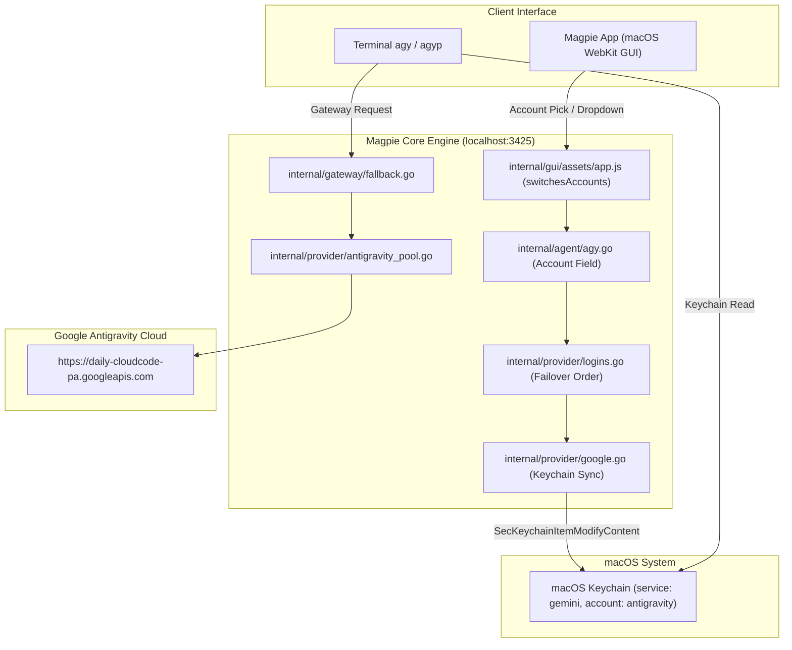

# Antigravity CLI (agy) Multi-Account Manual & System Architecture

> krazyeom Custom Build · Repository: [github.com/krazyeom/magpie](https://github.com/krazyeom/magpie)  
> Version: `v0.1.2374-krazyeom.1`

---

## 1. Overview and Background

Google's **Antigravity CLI (`agy`)** by default stores only a single OAuth refresh token in the macOS system Keychain (`service: gemini, account: antigravity`). The CLI itself provides no multi-profile switching command (such as `--profile`), making it difficult to switch between multiple Google accounts (e.g. multiple Google AI Pro accounts) or to automatically roll over when quota limits or rate limits are reached.

This custom fork (`krazyeom/magpie`) leverages the Magpie local AI gateway to provide:
* **Multi-account pooling and automatic failover**: Requests automatically transition to healthy backup accounts when rate limits (429) or quota exhaustion occur.
* **Native GUI account switching**: Switch primary accounts directly from the Agents page, the Agent configuration drawer, or the Providers quota cards.
* **Two-way macOS Keychain synchronization**: Switching an account in Magpie updates the macOS system Keychain atomically, ensuring that standalone `agy` commands in your terminal immediately use the chosen account.
* **All-in-one CLI wrapper (`agyp`)**: A convenience CLI for pool execution, account selection, and quota monitoring.
* **Isolated version management**: Custom build metadata in Settings › About and release tag `v0.1.2374-krazyeom.1` protected against upstream auto-update overwrites.

---

## 2. Key Features

1. **Multi-Account Pooling & Automatic Failover**:
   * Tracks real-time token and request allowances across all signed-in Antigravity accounts.
   * If the primary account hits a rate limit or runs out of allowance, the gateway seamlessly fails over to the next active account without failing the developer's request.
2. **Native 3-Way GUI Account Switching**:
   * **Agents Tab Quick Switcher**: Click the account badge next to the Antigravity CLI row for a pop-up menu of all registered accounts.
   * **Agents Detail Drawer**: Expand the row and pick any registered account from the `Account` dropdown field.
   * **Providers Tab**: View per-account quotas (Gemini, Claude & GPT) and click `Make first` to promote any account to the primary position.
3. **Atomic macOS Keychain Synchronization**:
   * When an account is switched in Magpie (GUI or CLI), the OAuth credentials in the macOS Keychain (`service: gemini, account: antigravity`) are immediately updated.
   * Standalone terminal executions (`agy -p "..."`) read the updated Keychain directly without requiring manual re-login.
4. **Unified CLI Wrapper (`agyp`)**:
   * Run pooled sessions, pick specific accounts, inspect quotas, and add new Google accounts with simple subcommands.
5. **Protected Versioning & Custom Metadata**:
   * Marked as a custom build in Settings › About with direct links to `krazyeom/magpie`.
   * Automated update protection ensures official upstream releases do not overwrite custom local builds.

---

## 3. GUI Operation Manual

```
[Magpie App GUI Account Switching Paths]
┌────────────────────────────────────────────────────────────────────────┐
│ 1. Agents Tab: Click the [● account@gmail.com] badge next to agy       │
│    └─ Select any account from the pop-up dropdown to switch instantly  │
├────────────────────────────────────────────────────────────────────────┤
│ 2. Agents Drawer: Click the agy row to open details, pick [Account]    │
│    └─ Choose from registered accounts in the dropdown                  │
├────────────────────────────────────────────────────────────────────────┤
│ 3. Providers Tab: Check quotas under [Antigravity] card                 │
│    └─ Click [Make first] to promote an account to 1st priority         │
└────────────────────────────────────────────────────────────────────────┘
```

### Path 1: Agents Tab Fast Switcher (Fastest)
1. In the Magpie application window, navigate to the **Agents** tab.
2. Locate the **Antigravity CLI** row.
3. Click the **account badge** (`.ag-acc.ag-who`, e.g. `● user@gmail.com`) located to the right of the name.
4. A pop-up menu displays all signed-in accounts. Click the target account to switch immediately.

### Path 2: Agents Detail Drawer
1. Click anywhere on the **Antigravity CLI** row to expand the configuration drawer.
2. Locate the **Account** field dropdown.
3. Select the desired account from the list. The change is saved and applied immediately.

### Path 3: Providers Tab (Quota Inspection & Promotion)
1. Navigate to the **Providers** tab.
2. Locate the **Antigravity** provider card.
3. Review the live allowances for each account (e.g. `Gemini 7d`, `Gemini 5h`, `Claude & GPT` remaining quotas and reset countdowns).
4. Click the **Make first** button on the account you wish to prioritize.

---

## 4. CLI Operation Manual

### 4.1 Account Inspection & Switching
```bash
# List all signed-in Antigravity accounts and quotas
magpie accounts antigravity

# Switch the active primary account (updates Magpie gateway and macOS Keychain)
magpie accounts switch antigravity <account_email>

# Add a new Antigravity Google account via browser OAuth
magpie accounts add antigravity
```

### 4.2 Unified CLI Wrapper: `agyp` (`agy-pool`)
The helper script `~/.local/bin/agyp` allows intuitive management from any terminal session:

```bash
# 1. Run agy with all registered accounts in automatic failover mode
agyp

# 2. Run agy with a prompt in pooled mode
agyp -p "Explain the architecture of this repository"

# 3. Prioritize a specific account for this invocation
agyp -a <account_email>

# 4. List accounts, failover order, and live quotas
agyp list

# 5. Add a new account
agyp add

# 6. Change the default primary account
agyp switch <account_email>

# 7. Check gateway connectivity and status
agyp status
```

### 4.3 Dedicated Account Isolation (Gateway Key Binding)
When you need strict isolation between work and personal accounts:

```bash
# 1. Create gateway keys bound to specific accounts
magpie gateway-key add agy-work
magpie gateway-key accounts agy-work antigravity/work@example.com

magpie gateway-key add agy-personal
magpie gateway-key accounts agy-personal antigravity/personal@example.com

# 2. Add shell aliases to your ~/.zshrc or ~/.bashrc
alias agy-work='GEMINI_API_KEY="<work-key>" GOOGLE_GEMINI_BASE_URL="http://127.0.0.1:3425" agy'
alias agy-personal='GEMINI_API_KEY="<personal-key>" GOOGLE_GEMINI_BASE_URL="http://127.0.0.1:3425" agy'
```

---

## 5. System Architecture and Implementation

### 5.1 Architecture Diagram



### 5.2 Key Source File Changes
* **`internal/agent/agy.go`**:
  * Added the `account` field with active getter (`FirstLogin("antigravity")`), setter (`SwitchLogin("antigravity", v)`), and account list options (`Logins("antigravity")`).
* **`internal/provider/google.go`**:
  * Implemented `syncAntigravityKeychain(user)` to write the active Google OAuth token directly into the macOS Keychain (`service: gemini, account: antigravity`).
  * Implemented `antigravityOwnLogin()` to discover existing Antigravity logins from the macOS Keychain.
* **`internal/gui/assets/app.js`**:
  * Added `agy` to `switchesAccounts` so the switcher badge appears on the Agents row.
  * Mapped `agy` to `antigravity` provider logins in `switchable`, `switchEntry`, and `switchAccountTo`.
  * Added the `Custom build` row in Settings › About pointing to `github.com/krazyeom/magpie`.
* **`internal/gui/assets/i18n.js`**:
  * Added localized translations for custom build and maintainer strings across supported languages.
* **`internal/update/update.go`**:
  * Updated `Released(v)` to return `false` when version contains `krazyeom`, preventing upstream automatic updates from overwriting the fork.
* **`Makefile`**:
  * Configured `VERSION` to prioritize `*-krazyeom*` git tags or append `-krazyeom`.
* **`build/darwin/Info.plist`**:
  * Set `NSHumanReadableCopyright` to `krazyeom (forked from yetone)`.

---

## 6. Build and Deployment Instructions

```bash
# 1. Build the binary and macOS application bundle
make app

# 2. Stop running instance and deploy to /Applications
pkill -f /Applications/magpie.app/Contents/MacOS/magpie
rm -rf /Applications/magpie.app
cp -R magpie.app /Applications/magpie.app

# 3. Launch the application
open -a /Applications/magpie.app

# 4. Verify version
/Applications/magpie.app/Contents/MacOS/magpie version
# Output: magpie v0.1.2374-krazyeom.1
```
